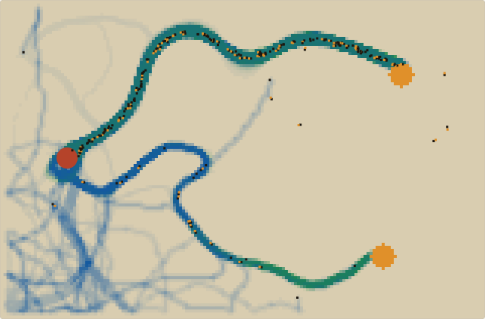
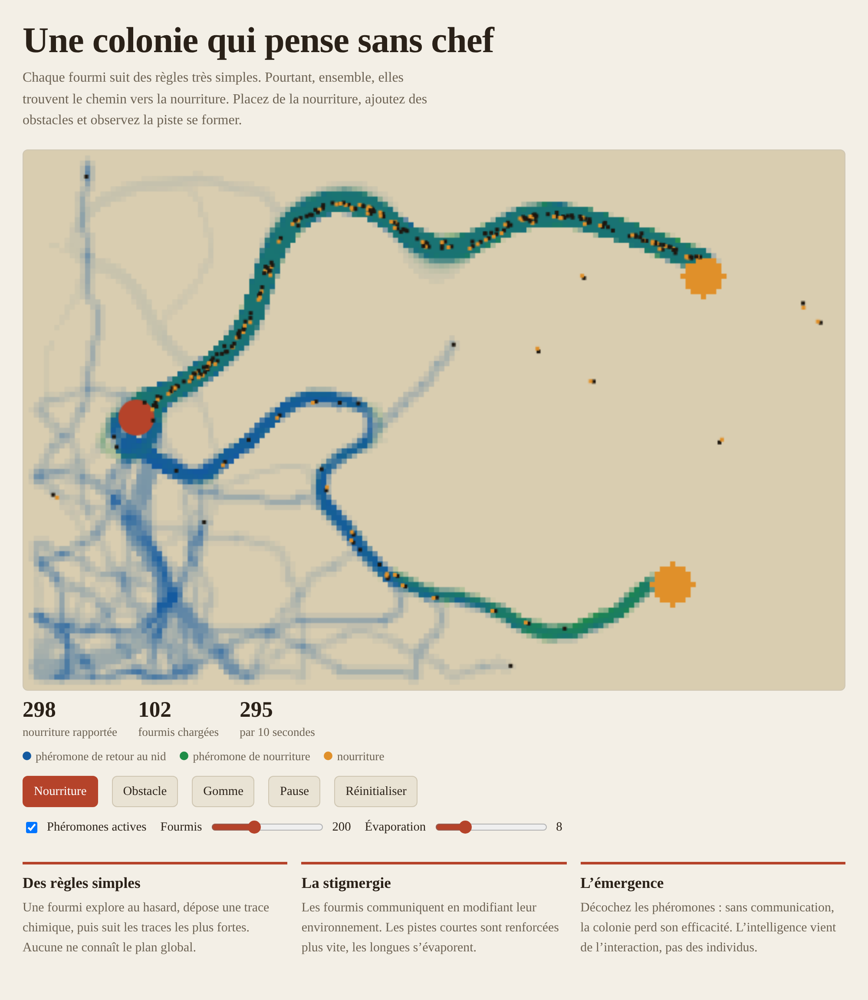

# Simulation interactive d'une colonie de fourmis

Une simulation dans le navigateur qui montre comment une colonie de fourmis trouve le chemin vers la nourriture **sans chef**, uniquement grâce aux phéromones : c'est l'**intelligence collective**.

Ce projet accompagne la présentation *Colonie de fourmis* du module **Intelligence collective et essaims** (Master IADAIG, 2026–2027).

*Après quelques secondes, les fourmis relient le nid (rouge) aux deux sources de nourriture (orange) par des pistes de phéromones.*

## Principe

Chaque fourmi suit des règles très simples :

1. elle explore au hasard depuis le nid ;
2. elle dépose une trace chimique (phéromone) en se déplaçant ;
3. elle suit les traces les plus fortes autour d'elle ;
4. quand elle trouve de la nourriture, elle la ramène au nid en déposant une phéromone de nourriture.

Les phéromones s'évaporent avec le temps : les pistes courtes, parcourues souvent, se renforcent, tandis que les pistes longues disparaissent. Ce mécanisme de communication indirecte par l'environnement s'appelle la **stigmergie**.

Deux phéromones sont utilisées :

- **bleue** : phéromone de retour au nid ;
- **verte** : phéromone de nourriture.

## Fonctionnalités

- **Nourriture** : cliquez ou glissez sur la zone pour placer de la nourriture.
- **Obstacle** : dessinez des murs que les fourmis doivent contourner.
- **Gomme** : effacez la nourriture et les obstacles.
- **Pause / Réinitialiser**.
- **Phéromones actives** : décochez pour voir la colonie perdre son efficacité sans communication.
- **Nombre de fourmis** : de 20 à 500.
- **Évaporation** : réglez la vitesse à laquelle les traces disparaissent.
- **Statistiques en direct** : nourriture rapportée, fourmis chargées, débit sur 10 secondes.
- Thème clair et sombre automatique.

## Aperçu de la page

## Utilisation

Aucune installation n'est nécessaire : ouvrez simplement `index.html` dans un navigateur.

### Mettre la simulation en ligne avec GitHub Pages

1. Sur GitHub, ouvrez le dépôt, puis **Settings → Pages**.
2. Dans **Source**, choisissez **Deploy from a branch**, branche `main`, dossier `/ (root)`.
3. Cliquez sur **Save**. Après une minute, la simulation est accessible à l'adresse
   `https://<votre-nom-utilisateur>.github.io/simulation-colonie-fourmis/`.

## Technologies

HTML, CSS et JavaScript, sans bibliothèque externe (rendu avec Canvas 2D).

## Auteurs

[@ibtissamdraoui2003](https://github.com/ibtissamadraoui2003-dot),
[@Yayalaaziz](https://github.com/Yayalaazizi),
[@maj-bakh](https://github.com/maj-bakh)

Master IADAIG – Academic Year 2026–2027.
